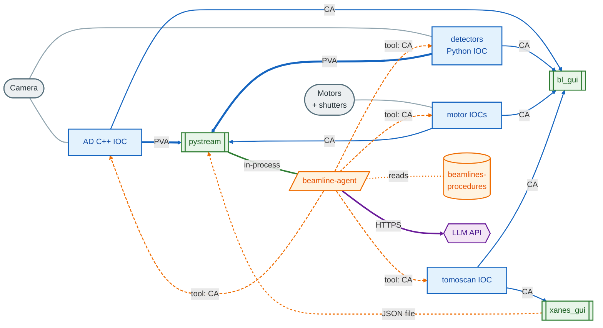
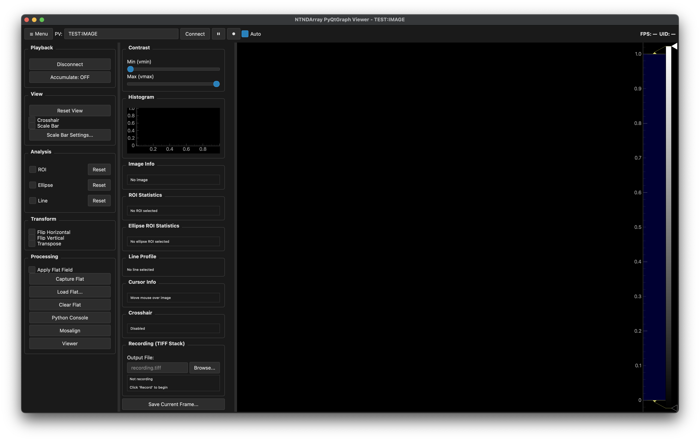

# APS 32-ID beamline software
## Stack overview — connections, trade-offs, improvements

 

Six first-party packages. Three protocols. One shared PV namespace.

**This deck**: who talks to whom, what works, what doesn't, where it needs to go.

---

## Module connection map

**Line legend**

| Line | Meaning |
|---|---|
| Thick blue | Camera image stream — PVA / NTNDArray |
| Thin blue | Read / write a single value on an IOC — EPICS CA |
| Grey | Hardware cable |
| Green | Function call inside the same Python process |
| Orange solid | One process writes a file; another reads it |
| Orange dashed (short) | Agent reads a file at startup |
| Orange dashed (long) | **Agent calls a tool that in turn reads / writes any IOC PV** |
| Purple | HTTPS to the LLM provider |

**Reading the agent's reach**

The agent is embedded inside pystream (green line). It also has a *tool
layer* — a set of Python functions it can call. Those tools do the
`caget` / `caput` on whatever IOC the task needs. So in practice the
agent can touch **every IOC on the stack**, not just pystream. The four
long-dashed orange lines show that.

---

## The three protocols

| Protocol | Carries | Who uses it | Why |
|---|---|---|---|
| **EPICS CA** | setpoints, readbacks, small values | every client ↔ every IOC | Universal, battle-tested, monitors deliver push updates |
| **EPICS PVA (NTNDArray)** | image frames | IOCs → pystream | High-bandwidth stream the standard was designed for |
| **File handshake** (JSON in `~/.pystream/`) | cross-process events | xanes_gui ↔ pystream (QGMax trigger) | Trivial, survives either side restart |
| **In-process Python calls** | tool invocations, live frame access | beamline-agent → pystream | µs latency, shared state (image, bus, widgets) |

Nothing uses sockets / RPC between clients. Nothing uses MCP.

---

## What works well

| Decision | Why it holds up |
|---|---|
| **Shared PV namespace** (AD + detectors speak same `cam1:`/`HDF1:`/`image1:`) | Clients don't care which IOC is running. Can swap underneath without GUI changes. |
| **PVA for images, CA for everything else** | Each protocol used for what it was designed for. |
| **Clients don't talk to each other** | No N² coupling. Every pairwise interaction mediated by a PV or a file. |
| **Agent in-process in pystream** | Cheap access to the live frame + plugin dispatch; no serialization tax. |
| **`~/.pystream/` as the shared state dir** | One place to look, one place to clear. |
| **Procedures as a separate data package** | Scientist edits markdown + `git push`; no code dep. |

---

## What hurts

| Problem | Where it bites |
|---|---|
| **File-based handshakes** (`qgmax_request.json`) | Polling latency (~500 ms). Dies on NFS hiccups. Only works between processes that share the filesystem. |
| **No shared PV cache across apps** | Each client opens its own CA monitors for the same PVs — N × duplication on a shared IOC. |
| **Two camera IOC paths coexist, not interchange** | Switching from AD C++ IOC to detectors Python IOC requires manual stop/start, config edits. No single-command handoff. |
| **In-process agent means single-client** | Can't drive the beamline from Claude Code / Desktop / a notebook. |
| **Clients hardcode `32idbSP1:cam1:…`** in many places | Changing camera prefix is a search-and-replace, not a config field. |
| **Autosave restores state at IOC restart** | Hidden coupling between what the client last wrote and what the IOC comes up with. Can mask real bugs. |

---

## What to improve

**Short term** (low cost, high value)

- Replace the QGMax file handshake with a dedicated EPICS PV so any client can trigger it uniformly and the latency drops to monitor-tick.
- Centralise the `32idbSP1:cam1:` prefix in one config block each client reads at startup.
- Shared PV-cache library (one-liner wrapper over `pvaccess.Channel`) — kill per-dialog `caget` subprocess calls.

**Medium term**

- MCP wrapper exposing a stateless subset of agent tools (motor move, caget / caput, run_tomoscan). Lets Claude Code drive the beamline without ripping up the in-process agent.
- Documented IOC handoff command (`switch_camera_ioc.sh ad|detectors`) that stops one and starts the other with correct autosave hooks.

**Long term**

- Unify the two camera-IOC codepaths behind a single launcher — pick the backend at runtime, no two source trees to maintain.
- Procedures as a queryable store (indexed by PV + topic) instead of path-based lookup.

---

## The stack in one picture

<!-- _class: diagram -->

<small>pystream — the central hub. Live camera stream, beamline control dialogs on the right, AI agent chat panel at the bottom.</small>

---

## Where to go deeper

| Deck | Focus |
|---|---|
| `01-pystream` | Image path, agent host, how it talks to IOCs |
| `02-bl_gui` | PVField + PVEngine wiring, how it talks to IOCs |
| `03-detectors` | Driver/GUI split, how it coexists with AD |
| `04-beamline-agent` | In-process vs MCP, tool invocation path |
| `05-beamlines-procedures` | Data flow from git → package → runtime |
| `06-xanes_gui` | QGMax interlock, cross-process coordination |

Each deck has its own **connection diagram + pros/cons/limits/improvements** slide.
