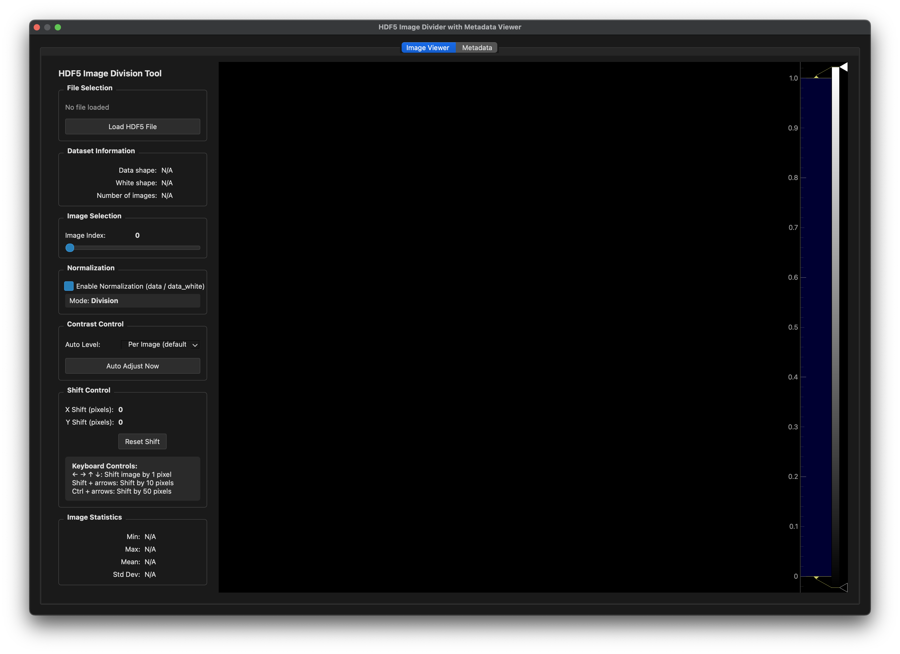
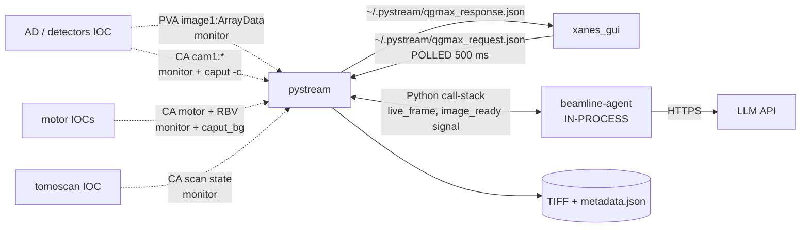

# pystream
## How it connects to everything else

 

**Role**: live image viewer + beamline control dialogs + agent host.

This deck: who pystream talks to, through what, and what we should change.

---

<!-- _class: diagram -->

<small>Main viewer. Left sidebar: capture controls + contrast + histogram. Centre: live camera frame with ROI overlay. Right: toolbar of beamline-specific dialogs.</small>

---

## Connection diagram

---

## Connection table

| Peer | Protocol | Direction | Payload | Freq | Reliability |
|---|---|---|---|---|---|
| AD / detectors IOC | PVA NTNDArray | pull/subscribe | image frame | up to ~30 fps | server-maintained monitor |
| AD / detectors IOC | CA `cam1:*` | both | int/float/str | on edit | monitor; subprocess caput -c for writes |
| motor IOCs | CA | both | motor pos / nudge | on edit / 1 Hz RBV | monitor |
| tomoscan IOC | CA | sub | scan state str | on change | monitor |
| xanes_gui | file JSON | both | QGMax request / response | 500 ms poll | survives either restart; needs shared FS |
| beamline-agent | in-process Python | both | fn call + np.ndarray | µs | locked to pystream |
| LLM API | HTTPS | out/in | messages | per chat turn | network-dependent |

---

## Pros of the current wiring

- **PVA for images, CA for control.** Each protocol doing what it's good at.
- **No RPC between clients.** pystream never talks to bl_gui / xanes_gui / detectors directly. All coordination through IOCs or file handshake. Zero N² coupling.
- **Agent in-process → sees the live `pg.ImageView` frame directly.** No pickling, no copies, no stream re-subscription.
- **Stream PV auto-pick**: client probes defaults (AD or detectors prefixes), first responder wins — same code works whether the vendor or the Python IOC is up.

---

## Cons / limits

- **`caget` / `caput -c` subprocess per PV op** in dialogs: ~5–20 ms per call, fork + exec overhead, uses `subprocess.run` env from the shell.
- **No shared PV cache.** Each dialog opens its own channels; the same PV may have N monitors in one process.
- **QGMax trigger via file**: 500 ms polling floor. Dies silently on NFS hiccup. No way to trigger from a non-pystream, non-xanes_gui client (notebook, agent, Claude Code).
- **Agent locked to this process.** Can't be driven externally.
- **Camera prefix hardcoded** (`32idbSP1:cam1:`) in ~5 dialog files. Changing cameras is a search-and-replace.
- **Image coordinates ≠ sensor coordinates.** View ops (decimation, flip, flat-field) make it easy to send wrong-space values back to the IOC.

---

## Possible improvements

**Short term**

- **Shared PV cache**: one `pvaccess.Channel` per PV name process-wide. Dialogs read from cache, write via `caput -c` once.
- **Centralise camera prefix** in `~/.pystream/viewer_config.json`; dialogs read it instead of hardcoding.
- **Add log + telemetry around subprocess caputs** — count, p50/p99 latency — so we know when the subprocess path becomes the bottleneck.

**Medium term**

- **Replace QGMax file handshake with an EPICS PV** (`32id:qgmax:request` string + ts). Any client can trigger; polling drops to monitor-tick latency.
- **MCP wrapper around the stateless agent tools** so Claude Code can drive the beamline when pystream isn't open.
- **Expose `image_ready` as an in-process bus** usable by any plugin without reaching into `PvViewerApp` internals.

**Long term**

- Replace subprocess caput with `pyepics` or `pvaccess.Channel.put` for lower latency, matching the monitor path.
- Pluggable sensor-coord ↔ image-coord mapping centralised in the viewer so dialogs stop re-deriving it.
