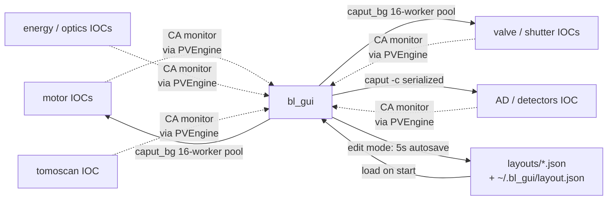

# bl_gui
## How it connects to everything else

 

**Role**: layout-driven PV control panel (motors / shutters / cam setpoints).

This deck: who bl_gui talks to, through what, and what we should change.

---

## Connection diagram

---

## Connection table

| Peer | Protocol | Direction | Payload | Freq | Reliability |
|---|---|---|---|---|---|
| motor IOCs | CA | both | motor pos / nudge | monitor + fire-and-forget write | subprocess caput, 16-worker pool |
| valve / shutter IOCs | CA | both | bo / mbbo | monitor + button-triggered write | same |
| AD `cam1:` (Bin X/Y) | CA | both | int | monitor + Enter-triggered | **serialized**: `caput -c` on background thread |
| energy / optics IOCs | CA | both | float | monitor + Enter | subprocess caput |
| tomoscan IOC | CA | sub | state str | monitor | monitor |
| layout JSON | file | both | layout dict | load once + 5 s autosave in edit mode | atomic rename |
| pystream, xanes_gui, agent | **none** | — | — | — | bl_gui is independent of them |

---

## Pros of the current wiring

- **PVEngine with persistent CA monitors** = readbacks never go stale, no polling tax on the IOC.
- **No dependency on pystream / xanes_gui / agent.** bl_gui ships, installs, launches on its own. Decoupled client.
- **Layout is pure data (JSON)**. A beamline scientist with no Python can rearrange panels and click Save. Changes land in git.
- **5-second autosave in edit mode** → forced close doesn't lose a rearrangement.
- **Dedicated Apply Binning path** disconnects PVField's default caput_bg handler, serializes writes with `caput -c` on a background thread, re-reads post-bin `MaxSize_RBV`. Correct for Oryx hardware binning.

---

## Cons / limits

- **`caput_bg` is a 16-worker unordered pool.** Writes that cross-constrain PVs race (bin + size, min + size, trigger + exposure). Each handler that cares must either serialize itself or disconnect the default.
- **Writes go through subprocess `caput`.** Fork + exec per PV = ~5–20 ms per write; adds up on multi-field apply flows.
- **One `PVField` per PV, per-tab.** Expert Mode and User Mode each build their own camera panel → two monitors on `BinX`, two on `SizeX_RBV`, etc. Doubled subscriptions on the IOC side.
- **No shared cache with pystream.** Both apps run on the same host, both open monitors on `MaxSizeX_RBV`. 2× the CA traffic.
- **Camera prefix is a Python string literal** (`"32idbSP1:cam1"`) in `_apply_cam_binning`. Not in the layout JSON. Switching cameras needs a code edit.
- **No way to drive bl_gui from a script.** No CLI, no RPC, no MCP. Everything goes through the Qt event loop.

---

## Possible improvements

**Short term**

- **Move the camera prefix into layout JSON** (`camera_prefix: "32idbSP1:cam1"`); `_apply_cam_binning` reads from there.
- **Collapse duplicate monitors** across tabs: one monitor per PV, N PVFields read from it. Would save CA subscriptions and keep tabs in sync by construction.
- **Audit log for destructive caputs** (motor moves, valve toggles) with timestamps.

**Medium term**

- **Shared PV cache library** (same one pystream + xanes_gui would use) so one process = one monitor per PV, cross-app.
- **Replace subprocess `caput_bg` with `pvaccess.Channel.put`** — kill fork overhead, keep ordering guarantees per Channel.
- **Headless CLI** (`bl-cli set <field_id> <value>`) so scripts and the agent can drive bl_gui's PVs through the same path the GUI uses.

**Long term**

- **Pluggable layout backends** (JSON → YAML → declarative Python). Current JSON schema is fine but drifts whenever a new row kind lands.
- **Live cross-GUI sync**: edits in bl_gui's Expert Mode immediately reflect in pystream's Detector dialog (today they re-read via monitor; works but through CA round-trip).
