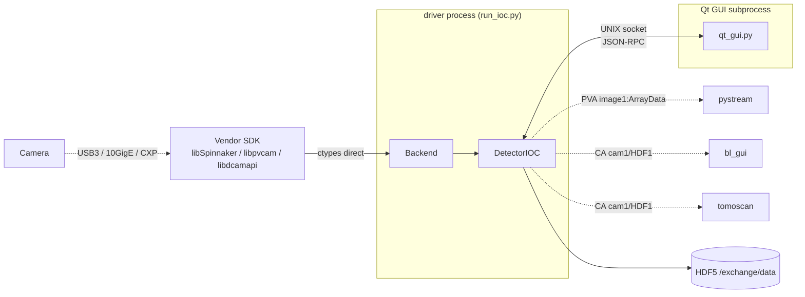

# detectors
## How it connects to everything else

 

**Role**: multi-camera Python IOC + Qt GUI, replaces AreaDetector C++ IOC where we need it to.

This deck: who detectors talks to, through what, and what we should change.

---

## Connection diagram

---

## Connection table

| Peer | Protocol | Direction | Payload | Freq | Reliability |
|---|---|---|---|---|---|
| Camera | USB3 / 10GigE / CXP | both | pixels + control | continuous | vendor SDK |
| Vendor SDK | ctypes | both | fn calls | per op | pure in-process |
| pystream | PVA NTNDArray | out | image frame | ~30 fps throttled | server-maintained |
| bl_gui, tomoscan | CA `cam1:` / `HDF1:` | both | int/float/str | monitor + caput | caproto IOC |
| Qt GUI (own subprocess) | UNIX socket JSON-RPC | both | full backend surface | per op | local socket at `/tmp/detector_ioc_<prefix>.sock` |
| HDF5 writer | file | out | uint16 frames | unthrottled | h5py |
| AreaDetector C++ IOC | **none** | — | — | — | they coexist, don't integrate |

---

## Pros of the current wiring

- **Same PV namespace as AreaDetector** (`cam1:` / `HDF1:` / `image1:`). Clients don't care which IOC is running underneath.
- **Driver and GUI in separate processes.** Side-steps PVCAM-vs-Qt signal-handler conflict uniformly. GUI can crash without touching the camera.
- **ctypes to vendor SDKs** — no vendor Python wrappers (no PySpin / PyVCAM lag behind Python versions).
- **UNIX socket IPC exposes the FULL backend surface** (every GenICam node, every DCAM property) — the Qt GUI can edit things CA doesn't model.
- **HDF5 layout as JSON** (`hdf5_layout.json` in-package). Edit the frame-type → dataset mapping without touching Python.

---

## Cons / limits

- **AD C++ IOC and detectors Python IOC don't share state.** Switching between them is manual (stop one, start the other). No orchestrator.
- **Exclusive camera access**: Spinnaker / PVCAM / DCAM each claim the camera per-process. Running both IOCs at once = conflict.
- **UNIX socket is local-only**. Qt GUI must run on the same host as the driver.
- **No shared telemetry PV** telling clients which IOC is actually serving — they have to probe.
- **Camera list auto-registered at module import.** Can't selectively disable backends to avoid pulling a specific SDK's shared lib.
- **GUI's "full backend surface" view duplicates the AD cam1 PVs** — same param editable in two places with different write paths.

---

## Possible improvements

**Short term**

- **Expose a `detectors:active_ioc` PV** (string: `"ad"` or `"detectors"`) so clients can display which backend is live.
- **Launcher script** that stops the AD C++ IOC and starts `run_ioc.py` (or the reverse) atomically.
- **Per-camera `recording_metadata.json` variants** selected by active backend (today the single template hardcodes Oryx PV names).

**Medium term**

- **TCP transport for the IPC socket**, optional, so a remote Qt GUI can connect to a driver on another host.
- **Hot-swap backends in one process**: unload `OrcaFireDCAM`, load `TeledyneOryx`, no restart. Needs reset-and-rebuild of the IOC PV set.
- **Dedupe UNIX-socket surface vs CA PVs**: same param, same write path, agent/user/CA client all see the same echo.

**Long term**

- **Unify AD C++ IOC and detectors Python IOC behind one launcher.** Pick the backend at runtime (`--backend ad|detectors`). One source of PV truth per site.
- **Procedure-aware acquisitions** — HDF5 layout + per-frame attributes chosen by what the agent / scientist asked for, driven from `beamlines-procedures`.
