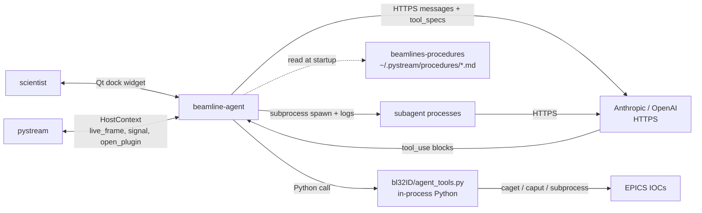

# beamline-agent
## How it connects to everything else

 

**Role**: AI chat + tool-use loop + sub-agent dispatch, embedded inside pystream.

This deck: who the agent talks to, through what, and what we should change.

---

## Connection diagram

---

## Connection table

| Peer | Protocol | Direction | Payload | Freq | Reliability |
|---|---|---|---|---|---|
| User | Qt widget | both | chat message | per keystroke / Enter | in-process |
| pystream | **HostContext** (Python protocol) | both | live frame ndarray, signals, plugin open | µs | locked to pystream |
| LLM API | HTTPS | both | messages + tool specs + results | per chat turn | network-dependent |
| `agent_tools.py` | in-process Python call | out | fn kwargs | per tool_use | µs |
| IOCs | CA / PVA via tools | both | PV values | per tool_use | subprocess caget / caput |
| procedures pkg | file read at startup | in | markdown | once per launch | optional |
| sub-agents | subprocess + stdout/stderr pipes | both | task + progress + result | per spawn | process boundary |

---

## Pros of the current wiring

- **Tools are plain Python calls**: µs latency, trivial to debug, no schema versioning.
- **Agent gets the LIVE frame** via `host.live_frame()` — no stream re-subscription, no serialization, just a numpy array.
- **HostContext is a Protocol**: nothing in the agent knows about pystream internals; a non-pystream Qt host could mount it tomorrow.
- **Sub-agents in subprocesses**: crash isolation + their own LLM session.
- **Procedures loaded as plain markdown**: scientist edits, `git push`, no code touched.
- **Console wire-trace of every tool call** → full audit trail for destructive ops.

---

## Cons / limits

- **Single client**: the agent can only be driven from pystream. Claude Code / Desktop / notebooks can't call these tools.
- **In-process = shares pystream's crash fate.** If pystream dies, the agent dies with it.
- **Tool specs live in `bl32ID/agent_tools.py` as hardcoded dicts** → changing the surface requires editing two files (anthropic + openai spec builders).
- **Sub-agents re-authenticate to the LLM independently** — N tokens, N retries, N rate-limit buckets.
- **No persistent memory across pystream restarts** (beyond learned notes). Context is gone when the chat panel is destroyed.
- **Procedures are read ONCE at startup.** Edit a procedure during a session → change not picked up until relaunch.
- **No MCP, so no interop with any non-first-party client.**

---

## Possible improvements

**Short term**

- **Hot-reload procedures**: watch `~/.pystream/procedures/` with inotify, re-ingest on change.
- **Deduplicate tool spec builders**: one declarative registry → anthropic + openai specs generated from it.
- **Persistent conversation store** keyed by sample / session so a pystream restart doesn't lose context.

**Medium term**

- **MCP wrapper exposing the stateless tool subset** (motor move, PV read/write, run_tomoscan). Stateful tools (`live_frame`, `open_plugin`) stay in-process. Lets Claude Code drive the beamline.
- **Shared LLM session for sub-agents** (one token source, shared rate-limit budget) via a local coordinator.
- **Streaming responses** from tools → chat UI updates while a long tool runs (today it blocks until result).

**Long term**

- **Agent-as-process-pool**: multiple agents on the beamline (one for ops, one for science, one for diagnostics) coordinating through an event bus — not an in-process singleton.
- **Vector-indexed procedures** (semantic search) so the agent finds the right procedure by task description, not by exact file name.
