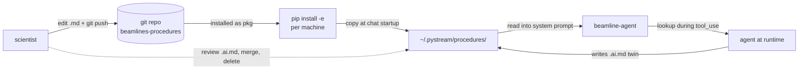

# beamlines-procedures
## How it connects to everything else

 

**Role**: hand-authored markdown knowledge base the AI agent reads at startup.

This deck: who reads/writes it, how it propagates, and what we should change.

---

## Connection diagram

---

## Connection table

| Peer | Protocol | Direction | Payload | Freq | Reliability |
|---|---|---|---|---|---|
| git repo | git clone / pull | both | markdown files | per author commit | human |
| pip install | setuptools | in | installs `beamlines_procedures` pkg | per machine, once | editable `-e` install |
| `~/.pystream/procedures/` | file copy (additive) | from pkg → home | markdown tree | once at pystream launch | skip-if-exists |
| beamline-agent | file read | from home → agent | markdown content | once at chat startup | optional (missing → agent runs anyway) |
| agent | file write | agent → home | `<topic>.ai.md` only | per observation | scientist's `.md` never touched |

> No PV. No socket. No RPC. Everything flows through git + the home directory.

---

## Pros of the current wiring

- **Pure data package.** No runtime code dep. Agent runs without it; pystream runs without it.
- **One source of truth per author** (the repo), N additive snapshots per machine (`~/.pystream/procedures/`).
- **Markdown + git**: scientist reviews diffs, rolls back, blames. No custom tooling.
- **Human/AI file split (`<topic>.md` vs `<topic>.ai.md`)** prevents the "AI corrupted my notes" failure mode outright.
- **Additive copy (skip-if-exists)**: user's local edits persist across restarts.
- **Decouples knowledge release cadence from code release cadence**: `git push` ships a procedure update; no pystream / agent release needed.

---

## Cons / limits

- **Read ONCE at chat startup.** Edit a procedure during a session → agent doesn't see it until pystream relaunches.
- **Additive copy means stale local files can shadow updates.** User has to delete `~/.pystream/procedures/<...>` manually to pick up the newer package version.
- **Path-based lookup only.** Agent asks for `<bl>/<cat>/<topic>.md` — doesn't know what's in the file until it reads it. No semantic search.
- **No index of what each procedure covers** → agent has to grep or guess.
- **Agent `.ai.md` writes are session-local.** No automatic push-back to the shared repo; scientist does the merge manually.
- **`-e` install only.** Regular `pip install .` works but `git pull` won't help — data would be inside `site-packages/`.

---

## Possible improvements

**Short term**

- **Inotify watcher** in beamline-agent: when a file under `~/.pystream/procedures/` changes, re-ingest it without a restart.
- **Index file** (`index.json`) auto-generated at build time listing each `<topic>.md` with a one-line description → agent picks relevant files by task description.
- **Doctor command**: `beamlines-procedures doctor` reports which local files are older than the package version and offers to overwrite.

**Medium term**

- **Vector index** (sentence-transformer embeddings of each `<topic>.md`) → agent retrieves by task description, not path.
- **Signed `.ai.md` entries** with provenance (which agent run, which sample, which PV state) so merge decisions have context.
- **Multi-beamline overlay**: procedures that apply to a detector across beamlines (cross-cutting), not just per-beamline.

**Long term**

- **Auto-propose PRs** from `.ai.md` content → scientist reviews, merges into `.md`. Closes the loop between observation and canonical doc.
- **Procedure execution engine**: the markdown becomes machine-readable enough for the agent to execute step-by-step with checkpoints, not just read for context.
