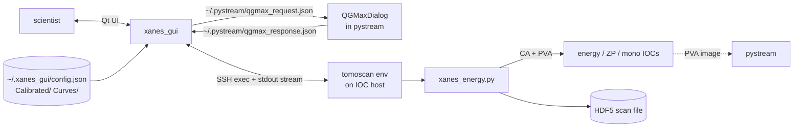

# xanes_gui
## How it connects to everything else

 

**Role**: XANES / XANES2D energy-scan orchestrator + QGMax interlock with pystream.

This deck: who xanes_gui talks to, through what, and what we should change.

---

## Connection diagram

---

## Connection table

| Peer | Protocol | Direction | Payload | Freq | Reliability |
|---|---|---|---|---|---|
| User | Qt UI | both | scan setup, start/stop | per interaction | in-process |
| pystream (QGMax) | **file handshake** JSON | both | request / response | 500 ms poll each side | survives either restart; needs shared FS |
| tomoscan env (remote host) | SSH exec | both | script invocation + stdout | per scan step | needs SSH keys, remote env online |
| `xanes_energy.py` | spawned by SSH | — | — | per scan | runs in own env on remote host |
| IOCs (indirectly via script) | CA + PVA | both | energy / motor / detector | continuous | subprocess inherits env |
| HDF5 scan file | file | out | datasets + attrs | per scan step | h5py |
| config / curve files | file | in | JSON config, CSV curves | once per launch | user-supplied |
| bl_gui / detectors / agent | **none** | — | — | — | no direct connections |

---

## Pros of the current wiring

- **GUI + CLI share one scan engine** (`xanes_gui/headless.py`). What you tested interactively is what runs in batch.
- **File-based QGMax interlock survives restart on either side** — pystream can restart mid-scan; xanes_gui can restart mid-step; the file is still there.
- **SSH to a dedicated tomoscan env** keeps the actual scan logic in the environment it was tested in — no shared-env conflicts with pystream's PyQt5 stack.
- **Reference curves + calibrated spectra are plain files in user-chosen directories** → scientist adds / removes without touching code.
- **No direct dep on pystream / bl_gui / agent.** xanes_gui can be developed and released independently.

---

## Cons / limits

- **500 ms polling floor on the QGMax handshake** — can't trigger faster than that.
- **File handshake requires shared filesystem** between xanes_gui host and pystream host. Breaks across machines without NFS / shared mount.
- **Only xanes_gui and pystream speak the handshake.** A notebook / agent / Claude Code wanting to trigger QGMax has to simulate the file protocol.
- **SSH to tomoscan env adds setup cost** (keys, remote path config, env activation) and ~1 s latency per step.
- **No in-process execution path** when xanes_gui runs on the same host as the IOC. Still SSHes to localhost.
- **Config lives in `~/.xanes_gui/config.json`** — separate from `~/.pystream/`. Two places to look for related settings.
- **Scan progress logged only to the embedded terminal.** Not written to a PV, not pushed to the agent / dashboard.

---

## Possible improvements

**Short term**

- **Dedicated EPICS PV for QGMax trigger** (`32id:qgmax:request` string + ts). Replaces the file; any client can trigger; latency drops to monitor-tick.
- **Scan progress PVs**: `32id:xanes:current_step`, `:total_steps`, `:current_energy`, `:state`. Lets pystream / agent / dashboards show it without parsing terminal output.
- **Config in `~/.pystream/xanes_gui.json`** → one state dir to back up and share.

**Medium term**

- **In-process scan execution** when xanes_gui runs on the IOC host (auto-detect; skip SSH).
- **Standard scan-event signal** on an EPICS PV (per step start / end) so other apps can listen without the SSH subprocess being in the loop.
- **QGMax API via MCP** (through the agent's MCP wrapper if we do that) — notebooks / Claude Code trigger QGMax uniformly.

**Long term**

- **Scan definition as a declarative file** (YAML/JSON) that xanes_gui, the agent, and tomoscan can all consume → one source of truth for "the scan I want to run".
- **Resume-on-crash**: scan state persisted every step so a mid-scan restart picks up at step N+1 instead of restarting.
